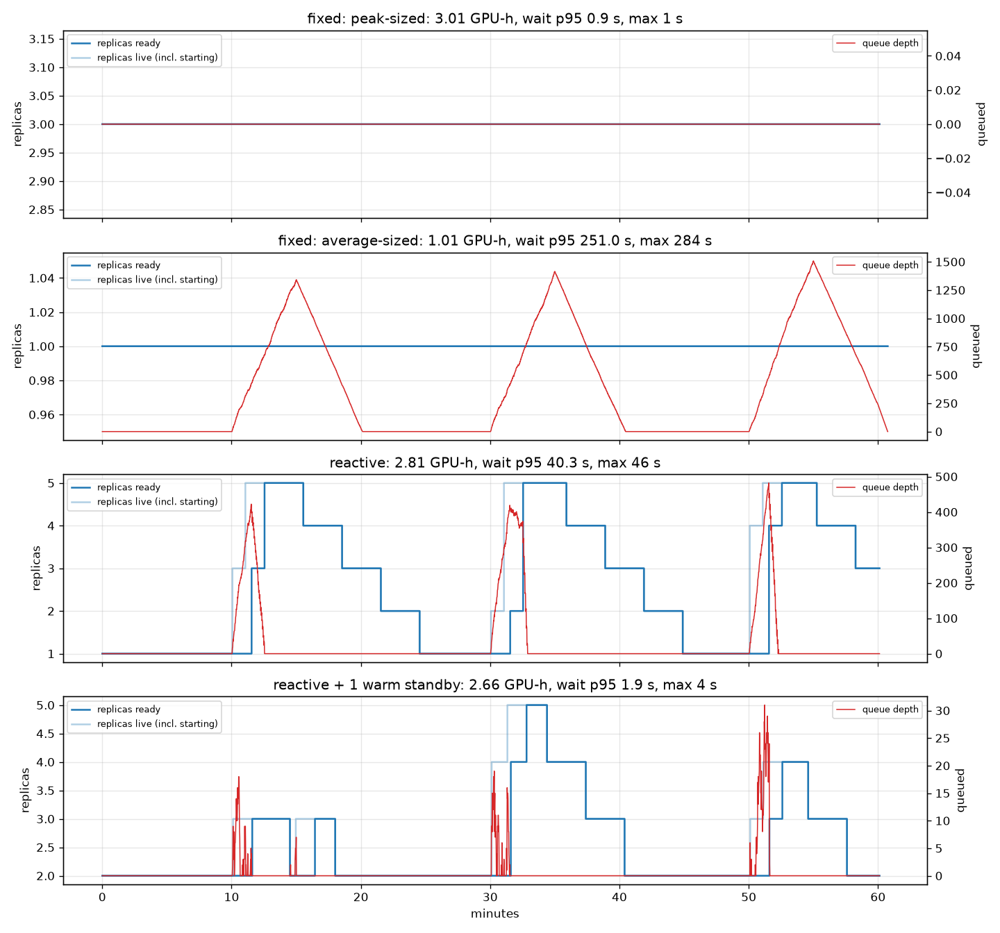
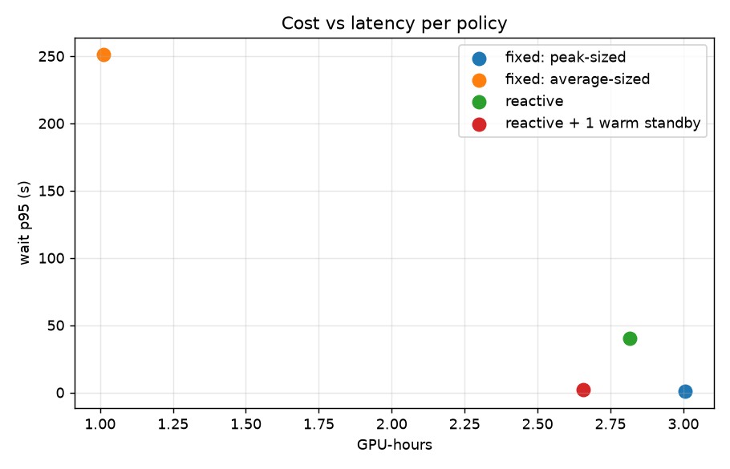

# gpuscaler

Queue-depth-driven autoscaler for GPU inference replicas (KEDA-style) with cold-start mitigation, validated against replayed traffic traces.

Project 11 of 15 in [inference-infra-portfolio](https://github.com/NomanJafar/inference-infra-portfolio).

## What this builds

KEDA-style scaling of inference replicas on pending-request queue depth, with cold-start mitigation.

## Why it matters

GPUs idling at 30% utilisation burn money. Autoscaling is FinOps.

## Status

Done. This project needs no GPU: the policies are compared on a simulated pool calibrated with the T4 numbers from [servellm](https://github.com/NomanJafar/servellm) (capacity 16 concurrent requests per replica, ~3 s per request, 90 s from launch to ready), and the same controller is proven against real mock replicas in a test. Raw data: [`results/replay/`](results/replay/).

## What is in here

| Module | Purpose |
|---|---|
| `gpuscaler.policy` | `QueueDepthPolicy`: desired = ceil(queue / target), clamped to min/max; scale-up cooldown; HPA-style scale-down stabilisation window (the metric must have fitted a smaller pool since the last high sample or pool change), one replica per step |
| `gpuscaler.sim` | Discrete-time pool simulator: replicas with a concurrency capacity and a cold start during which they serve nothing but are billed; per-request waits; GPU-hours |
| `gpuscaler.trace` | Poisson baseline with repeating rectangular bursts |
| `gpuscaler.replay` | Runs four policies on one trace: fixed peak-sized, fixed average-sized, reactive, reactive + one warm standby; table and plots |
| `gpuscaler.controller` | The same policy driving real [tokenbench](https://github.com/NomanJafar/tokenbench) mock replicas as subprocesses, reading `vllm:num_requests_waiting` from their `/metrics` |
| `k8s/scaledobject.yaml` | The policy expressed as a KEDA `ScaledObject` + HPA behaviour, for the real thing |

16 tests, including the controller scaling a live mock pool from 1 to 3 replicas when requests queue.

## Usage

```bash
pip install "git+https://github.com/NomanJafar/gpuscaler"
gpuscaler replay --capacity 16 --service-time 3 --cold-start 90 --base-rate 1 --burst-rate 10 --burst-len 300 --repeat-every 1200
gpuscaler demo --seconds 60 --rate 6      # real mock replicas on your laptop, watch the pool grow and shrink
```

## Results (simulated pool, T4-calibrated, one hour, three 5-minute 10x bursts)

Trace: 1 request/s baseline, 10 requests/s for 5 minutes every 20 minutes (11,777 requests). Replica: 16 concurrent requests at its good operating point, 3 s per request, 90 s cold start. Policy: target 4 queued requests per replica, 60 s scale-up cooldown, 180 s scale-down window, one replica per step, 1–5 replicas. "Wait" is time in queue before a replica picked the request up; the simulator's 1 s tick puts a floor of ~0.5 s median on every row.

| policy | GPU-hours | peak replicas | wait p50 | p95 | p99 | max | peak queue | served | unserved |
|---|---|---|---|---|---|---|---|---|---|
| fixed: peak-sized | 3.007 | 3 | 0.5 s | 0.9 s | 1.0 s | 1.0 s | 0 | 11777 | 0 |
| fixed: average-sized | 1.013 | 1 | 111.0 s | 251.0 s | 273.4 s | 283.9 s | 1508 | 11777 | 0 |
| reactive | 2.815 | 5 | 0.8 s | 40.3 s | 43.2 s | 46.0 s | 482 | 11777 | 0 |
| reactive + 1 warm standby | 2.655 | 5 | 0.6 s | 1.9 s | 2.8 s | 3.8 s | 31 | 11777 | 0 |




### What the numbers say

1. **Sized for the average, the pool is a disaster at every burst:** the queue reaches 1,500 and the p95 wait is over four minutes, for 1.0 GPU-hour. Sized for the peak (3 replicas with 50% headroom), nobody waits and the bill is 3.0 GPU-hours, two thirds of it idle.
2. **Reactive scaling on queue depth barely saved money here: 2.8 GPU-hours against 3.0, with 40-second waits at the start of every burst.** The wait is the cold start: the policy decided within seconds, but each new replica served nothing for 90 s while the queue climbed to 480; by the time the replicas were ready the policy had asked for the maximum, five, which then took ~12 minutes to come back down one step per 3-minute window. Most of the "saving" was eaten by the overshoot and the slow descent. Faster scale-down would cut the bill and raise the risk of flapping; that is the knob, and it is a judgement about the traffic, not a tuning constant.
3. **One warm standby beat reactive scaling on both axes: 2.66 GPU-hours and a p95 wait of 1.9 s.** The standby absorbed the first wave of each burst, so the queue never built, so the policy never overshot; the standby's own idle hours cost less than the overshoot it prevented. Against the peak-sized pool it saved 11% of GPU-hours for a 1-second p95 instead of 0; against reactive it saved money *and* latency. This is the FinOps answer on this trace: pay for one idle replica, not for the cold start twice.
4. **Cold start is the parameter that decides everything.** With a 90 s cold start the reactive policy cannot react inside a 5-minute burst; with a 10 s one it would track the trace closely and the standby would be a pure cost. The number comes from a measurement (servellm: launch to `/health` on a T4), and any change to it (sleep mode, pre-loaded weights, bigger models) changes the recommendation. Re-run the replay with `--cold-start` before trusting this table for another stack.

### What was not measured

Real vLLM replicas being launched and killed (the controller test uses mock replicas, which start in milliseconds; the cold start is simulated); per-second cloud billing granularity and instance start-up queues; predictive scaling; scale-to-zero (the trace never goes quiet long enough).

## Layout

```
CONCEPTS.md     the theory behind the project, written before the code
src/gpuscaler/   implementation
tests/          CPU-only tests, runnable on a laptop
notebooks/      GPU notebooks (Kaggle / Colab) that run the experiments and write results/
results/        measured numbers and plots
```

## Running

```bash
python -m venv .venv && source .venv/bin/activate
pip install -e ".[dev]"
pytest
```

GPU experiments run from `notebooks/`; each notebook clones this repo, installs it and writes its outputs to `results/`.

## Hardware notes

Developed against free-tier GPUs (Kaggle and Colab T4, 16 GB). Where a T4 limits what can be measured (no FP8, Turing-era kernels), the README says so rather than papering over it.

## License

MIT
